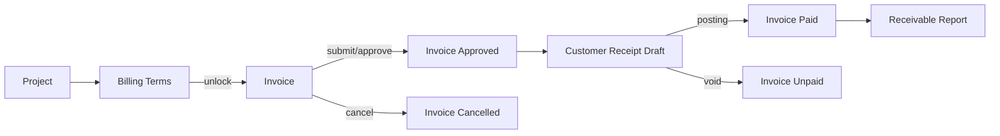
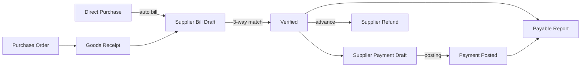

# Analisa Modul Group Finance — HAS-ERP

## 1. Ringkasan Eksekutif

Finance adalah domain dengan kontrol paling ketat di HAS-ERP: pemisahan dokumen sumber (Project/PO),
dokumen pengakuan (Invoice/Supplier Bill), dokumen pembayaran (Customer Receipt/Supplier Payment),
serta laporan turunan (Receivable/Payable Report). Kekuatan utamanya:

- Approval workflow konsisten (`draft → waiting_approval → approved/rejected`) untuk Invoice.
- AP memakai 3-way match PO × Penerimaan × Tagihan, uang muka, PPh, PPN, dan valas.
- AR memakai billing term project, satu invoice aktif per termin, dan receipt yang memposting
  invoice menjadi lunas.
- Semua nomor dokumen memakai `NumberSequence`; semua aksi penting menulis `Log::record`.
- Laporan AP/AR memisahkan nilai buku, nilai bayar, dan selisih kurs.

Risiko utama yang ditemukan:

| Peringkat | Risiko |
|---|---|
| P0 | `invoice.cancel` dipetakan ke `can_create`, bukan permission approval |
| P0 | Kebijakan maker-checker tidak seragam dan bertentangan dengan deskripsi modul |
| P0 | Tidak ada constraint DB untuk satu receipt aktif per invoice |
| P0 | Uniknya invoice supplier hanya dijaga aplikasi, bukan index DB |
| P1 | Rekonsiliasi laporan AP/AR belum konsisten untuk advance/PPh/retur/invoice non-approved |
| P1 | Scoping branch/company dan record-level authorization belum ada |
| P2 | Validasi parameter, edit refund, credit note, scheduler, dan performa laporan |

## 2. Ruang Lingkup dan Metode

**Cakupan:** `invoice`, `customer-receipt`, `receivable-report`, `supplier-bill`,
`supplier-payment`, `supplier-refund`, `payable-report`, `finance-notification`, beserta
model/support/notifier yang dipakai langsung.

**Metode:** analisa statis source, route, migration, model, support, dan feature test.
Test suite tidak dijalankan pada lingkungan ini karena PHP CLI sandbox gagal
(`GLIBCXX_3.4.30` tidak tersedia); temuan diverifikasi dengan membaca kode dan test.

**Definisi severity:**

- **P0/Tinggi** — akses tidak semestinya atau integritas data uang bisa rusak.
- **P1/Sedang** — laporan/validasi salah atau alur tidak konsisten, tetapi tidak langsung
  membuka akses.
- **P2/Rendah** — operasional, performa, duplikasi, atau gap desain jangka panjang.

## 3. Inventaris Modul

| Modul | Route base | Controller | Model/tabel utama | View | Test |
|---|---|---|---|---|---|
| Invoice | `invoice` | `InvoiceController` | `Invoice`, `InvoiceItem`, `ProjectBillingTerm`, `Document` | `invoice/` | `InvoiceTest`, `ProjectBillingTimelineTest`, `DocumentNumberTest` |
| Penerimaan Customer | `customer-receipt` | `CustomerReceiptController` | `CustomerReceipt`, `Invoice`, `AccountCompany` | `customer-receipt/` | `CustomerReceiptTest`, `InvoiceTest` |
| Laporan Piutang | `receivable-report` | `ReceivableReportController` | `ReceivableReport` (tanpa tabel sendiri) | `receivable-report/` | `ReceivableReportTest` |
| Tagihan Supplier | `supplier-bill` | `SupplierBillController` | `SupplierBill`, `SupplierBillItem`, `PurchaseOrder`, `DirectPurchase` | `supplier-bill/` | `SupplierBillTest`, `SupplierTaxReturnTest`, `SupplierAdvanceRefundTest`, `SupplierForeignCurrencyTest` |
| Pembayaran Supplier | `supplier-payment` | `SupplierPaymentController` | `SupplierPayment`, `SupplierPaymentAllocation`, `SupplierBill` | `supplier-payment/` | `SupplierPaymentTest`, `SupplierForeignCurrencyTest` |
| Refund Supplier | `supplier-refund` | `SupplierRefundController` | `SupplierRefund`, `PurchaseOrder`, `SupplierBill` | `supplier-refund/` | `SupplierAdvanceRefundTest`, `SupplierForeignCurrencyTest` |
| Laporan Hutang | `payable-report` | `PayableReportController` | `PayableReport` (tanpa tabel sendiri) | `payable-report/` | `PayableReportTest`, `PayableDueReminderTest` |
| Notifikasi Finance | `finance-notification` | `FinanceNotificationController` | `AppSetting`, `WhatsAppGroup` | `finance-notification/` | `FinanceNotificationTest`, `PayableDueReminderTest` |

Catatan: `finance-notification` berada di grup Master Data, tetapi satu domain dengan Finance.
Semua route berada dalam grup middleware `auth` + `access.control` (`routes/web.php:72`).

## 4. Arsitektur AR (Piutang)

### 4.1 Billing term

- Dibuat di form Project; total persen ≤ 100% (`ProjectController::validatedBillingTerms`
  `app/Http/Controllers/ProjectController.php:1077-1121`).
- Termin awal terkunci; dibuka lewat `PATCH project/{id}/billing-terms/{term}/access`
  (`ProjectController::updateTermAccess`).
- `ProjectBillingTerm` (`app/Models/ProjectBillingTerm.php:64-124`):
  - `activeInvoice()` = invoice bukan `cancelled`;
  - `isOpen()` = sudah unlock dan belum punya invoice aktif;
  - termin dengan invoice aktif tidak bisa diubah persen/dikunci/dihapus;
  - status tampilan: Terkunci / Open / Draft / Menunggu Approval / Ditolak / Belum Dibayar / Lunas.

### 4.2 Invoice

- Route: `routes/web.php:340-353`.
- Pembuatan invoice (`InvoiceController::store` `:134-188`) memvalidasi:
  - termin milik project;
  - termin sudah unlock;
  - satu invoice aktif per termin;
  - `percent_payment` mengikuti persen termin;
  - invoice tanpa termin wajib `non_term_reason`;
  - total invoice mengikuti nilai kontrak/termin, bukan input bebas.
- Perhitungan (`InvoiceController::calculateTotals` `:852-910`):
  - `amount_payment = subtotal × percent_payment / 100`;
  - PPN dihitung dari `amount_payment`;
  - `total_payment = amount_payment + PPN`.
- Approval:
  - `submit` `:394-432` → `waiting_approval`, minimal 1 item;
  - `approve` `:434-465` → `approved`, mengisi `final_checked_by`;
  - `reject` `:467-502` → `rejected`, alasan wajib.
- Edit/hapus hanya saat `draft`/`rejected` (`Invoice::canBeModified`).
- `cancel` `:504-548` hanya untuk invoice Approved + Unpaid, alasan wajib, dan ditolak jika
  ada receipt aktif.
- Pajak: `tax_invoice_number` boleh diisi setelah Approved selama invoice belum cancelled
  (`updateTaxInvoice` `:554-586`).

### 4.3 Customer Receipt

- Route: `routes/web.php:356-363`.
- `openInvoices` `app/Http/Controllers/CustomerReceiptController.php:111-131` hanya menampilkan
  invoice Approved + Unpaid tanpa receipt aktif.
- Draft menyimpan nominal = `invoice.total_payment`; input amount diabaikan.
- Posting (`approve` `:206-239`) mengunci invoice, cek ulang `canRecordPayment()`, set receipt
  `posted`, invoice `paid`, lalu mengisi `date_payment/reference_number/paid_by`.
- Void (`:241-270`) wajib alasan; receipt `void`; invoice kembali `unpaid` dan field pembayaran
  dikosongkan.
- Draft bisa dihapus; Posted hanya bisa void.

### 4.4 Laporan Piutang

`App\Support\ReceivableReport`:

- `openInvoices()` = invoice Approved + Unpaid (`app/Support/ReceivableReport.php:49-56`).
- `termPosition()` / `termAmount()` / `termExpectedDate()` / `isLateBilling()`.
- `customerSummary()` dan `forecast()` mingguan.
- `projectSummary()` menggabungkan posisi termin, tagihan di luar timeline, dan status PO due date.

## 5. Arsitektur AP (Hutang)

### 5.1 Sumber tagihan

- PO yang boleh ditagih: `approved`, `partially_received`, `received`, `cancelled`
  (`SupplierBillController::BILLABLE_PO_STATUSES` `:45-51`).
- Direct Purchase approved otomatis membuat bill `Verified` melalui
  `SupplierBill::createFromDirectPurchase` (`app/Models/SupplierBill.php:324-372`), tanpa
  3-way match.

### 5.2 Supplier Bill

- Route: `routes/web.php:525-532`, plus `pph-slip` dan `exchange-rate` di `:555-556`.
- 3-way match (`SupplierBillController::matchLines` `:423-463`):
  - qty ≤ `receivedQty() − billedQty()`;
  - harga dalam toleransi 1% (`SupplierBill::PRICE_TOLERANCE_PERCENT`);
  - nomor invoice supplier unik per supplier non-void (`ensureUniqueInvoice` `:616-627`).
- Uang muka:
  - tipe `advance`; hanya PO receivable;
  - batas `PO netTotal × supplier.max_advance_percent`;
  - total advance non-void ≤ batas;
  - potongan advance dihitung ulang saat verifikasi (`applyAdvance` `:549-558`).
- Total (`SupplierBill::recalculate` `:296-317`):
  - subtotal item + charge;
  - diskon persen;
  - DPP = subtotal − diskon + charge;
  - PPN dari DPP;
  - `amountDue = total − advance_deduction − pph_amount`.
- Verifikasi (`approve` `:288-323`): cek ulang 3-way match, faktur pajak wajib untuk supplier
  PKP ber-PPN, hitung ulang advance, status `verified` atau langsung `paid`.
- Void (`:325-343`): hanya Draft/Verified dan `paidAmount() <= 0`; alasan wajib.

### 5.3 Supplier Payment

- Route: `routes/web.php:534-541`.
- Draft memilih satu supplier, banyak bill terbuka, satu mata uang per pembayaran
  (`matchAllocations` `:324-361`).
- Posting (`approve` `:242-267`): lock bill, cek status terbuka dan nominal ≤ outstanding,
  set payment `posted`, refresh status bill.
- Void (`:269-291`): wajib alasan, payment `void`, status bill dihitung ulang.
- Alokasi menyimpan nilai buku (kurs bill), nilai bayar (kurs bayar), dan `fx_difference`
  (`withPaidBase` `:392-405`).

### 5.4 Supplier Refund

- Route: `routes/web.php:543-549`; resource hanya `index/create/store/show/destroy`
  (tidak ada edit/update).
- Sumber: PO dengan advance bill non-void dan `refundDue() > 0`.
- Store (`:99-150`): nominal ≤ `refundDue − draft refund lain`; valas wajib kurs.
- Approve (`:176-192`): cek ulang `refundDue`, posting.
- Void (`:194-207`): wajib alasan, saldo refund kembali.
- FX refund memakai kurs buku advance dan kurs aktual refund (`fxAttributes` `:213-218`).

### 5.5 Laporan Hutang

`App\Support\PayableReport`:

- `openBills()` = bill verified/partially paid/paid dengan outstanding > 0.
- `supplierByCurrency()`, `aging()`, `schedule()`.
- `projectBills()` — daftar tagihan per project.
- `projectCosts()` — komitmen, diterima, ditagih, dibayar, alokasi stok, FX, variance vs
  Estimasi PL.
- `fx()` — realized/unrealized.

## 6. Komponen Bersama

| Komponen | Fungsi |
|---|---|
| `App\Support\PayableReport` | Semua angka AP: open bills, aging, schedule, project cost, FX |
| `App\Support\ReceivableReport` | Semua angka AR: open invoices, posisi termin, customer/project summary, forecast |
| `App\Services\PayableDueNotifier` | Digest WhatsApp hutang; setting `finance.due_reminder` |
| `App\Services\ReceivableDueNotifier` | Digest WhatsApp piutang; setting `finance.receivable_reminder` |
| `App\Services\Concerns\SendsWhatsAppDigest` | Kontrak digest: sekali per hari, grup + personal |
| `App\Models\Invoice` | Status/approval, active receipt, aturan cancel/payment |
| `App\Models\CustomerReceipt` | Status draft/posted/void, dokumen |
| `App\Models\SupplierBill` | 3-way match, total/PPN/PPh/advance, outstanding, void, auto bill DP |
| `App\Models\SupplierPayment` | Header pembayaran, kurs, status, alokasi |
| `App\Models\SupplierRefund` | Refund advance, kurs buku/aktual, FX |
| `App\Models\ProjectBillingTerm` | Timeline termin, unlock, active invoice, status |
| `App\Http\Controllers\Concerns\ManagesPurchaseDocuments` | Upload/view/delete dokumen |
| `App\Support\NumberSequence` | Nomor `INV-`, `RV-`, `BILL-`, `PV-`, `RFD-` |

## 7. Kontrol Akses

`CheckAccessControl` (`app/Http/Middleware/CheckAccessControl.php:49-67`) memetakan permission
dari segmen terakhir route + HTTP verb:

| Kondisi | Permission |
|---|---|
| `approve`, `reject`, `unlock`, `settle`, `pay`, `finalize`, `void` | `can_approve` |
| `revise` | `can_update` |
| `POST` | `can_create` |
| `PUT`/`PATCH` | `can_update` |
| `DELETE` | `can_delete` |
| lainnya | `can_read` |

Implikasi Finance:

| Route | Permission aktual | Catatan |
|---|---|---|
| `invoice.submit` | `can_create` | Submit draft |
| `invoice.approve/reject` | `can_approve` | Sesuai |
| `invoice.cancel` | **`can_create`** | Tidak masuk daftar approval verb |
| `customer-receipt.approve` | `can_approve` | Posting receipt |
| `customer-receipt.void` | `can_approve` | Void |
| `supplier-bill.approve/void` | `can_approve` | Verifikasi/void |
| `supplier-payment.approve/void` | `can_approve` | Posting/void |
| `supplier-refund.approve/void` | `can_approve` | Posting/void |
| `supplier-bill.pph-slip` | `can_update` | PATCH |
| `supplier-bill.exchange-rate` | `can_update` | PATCH |
| `finance-notification.update` | `can_update` | PATCH |
| `finance-notification.send` | `can_create` | POST |

Tidak ada record-level authorization, branch scope, atau company scope di controller Finance.
`InvoiceController::data` hanya memakai `company_id` sebagai filter opsional, bukan pembatas akses.

## 8. Register Temuan

### F-01 — `invoice.cancel` memakai permission `can_create` (P0)

**Bukti:** route `POST invoice/{id}/cancel` (`routes/web.php:351`); middleware tidak memasukkan
`cancel` ke daftar approval (`CheckAccessControl.php:56`); test mengizinkan creator cancel
(`tests/Feature/InvoiceTest.php:724-745`).

**Dampak:** user yang hanya punya `can_create` dapat membatalkan invoice yang sudah Approved,
selama invoice belum dibayar. Ini melemahkan kontrol pembatalan dokumen keuangan.

**Rekomendasi:** petakan `invoice.cancel` secara eksplisit ke `can_approve` (atau `can_update`
bila kebijakan produk mengizinkan pembuat membatalkan). Jangan menambah `cancel` global karena
akan mengubah `leave-request.cancel`, `overtime-request.cancel`, dan `task-planner.cancel`.

### F-02 — Maker-checker tidak seragam (P0)

**Bukti:**

- `InvoiceTest::test_creator_with_approve_permission_can_approve_own_invoice`
  (`tests/Feature/InvoiceTest.php:535-551`).
- `CustomerReceiptTest` secara eksplisit mengizinkan pembuat memposting receipt sendiri
  (`tests/Feature/CustomerReceiptTest.php:164-187`).
- `SupplierBillTest` mengizinkan pembuat memverifikasi bill sendiri
  (`tests/Feature/SupplierBillTest.php:154-158`), meskipun komentar test lain menyebut
  “pemisahan tugas”.
- `SupplierPaymentTest` mengizinkan pembuat memposting payment sendiri
  (`tests/Feature/SupplierPaymentTest.php:143-147`).
- Seeder Invoice menyebut “approval bukan oleh pembuat” (`ModulesTableSeeder.php:455`).

**Dampak:** kontrol four-eyes tidak dapat diandalkan; satu user dengan `can_create` +
`can_approve` dapat membuat dan menyetujui transaksi keuangan sendiri.

**Rekomendasi:** tetapkan satu kebijakan:

1. **Four-eyes** — pembuat tidak boleh approve/post/verify kecuali Admin; update test yang
   saat ini mengunci self-approval.
2. **Self-approval allowed** — hapus klaim “bukan pembuat” dari seeder/deskripsi dan dokumentasikan
   sebagai risiko yang diterima.

Rekomendasi utama: four-eyes dengan override Admin.

### F-03 — Tidak ada constraint DB satu receipt aktif per invoice (P0)

**Bukti:** `customer_receipts` hanya punya index status, bukan unique parsial
(`database/migrations/2026_11_04_000008_create_customer_receipts_table.php:14-33`). Pengecekan
hanya di `CustomerReceiptController::receivableInvoice` (`:294-309`).

**Dampak:** dua request paralel dapat membuat dua receipt aktif untuk satu invoice; invoice bisa
tercatat lunas dua kali.

**Rekomendasi:** tambah constraint DB (partial unique index di PostgreSQL/SQLite; generated column
atau strategi lock di MySQL) untuk `invoice_id` selama status receipt bukan `void`; tetap gunakan
`lockForUpdate` di controller.

### F-04 — Unik invoice supplier hanya di aplikasi (P0)

**Bukti:** `supplier_bills` memakai index biasa `['supplier_id', 'supplier_invoice_number']`
(`database/migrations/2026_11_04_000002_create_supplier_bills_table.php:47-49`); pengecekan di
`SupplierBillController::ensureUniqueInvoice` (`:616-627`).

**Dampak:** race condition dapat membuat dua tagihan dengan nomor invoice supplier sama; hutang
tercatat ganda.

**Rekomendasi:** tambah unique index yang memperhitungkan status void. MySQL tidak mendukung
partial index; gunakan generated column (mis. `active_supplier_invoice_key`) atau transaksi
dengan lock supplier + pengecekan ulang.

### F-05 — Tidak ada branch/company/record-level scoping (P1)

**Bukti:** query Finance tidak memfilter `users.branch_id`; `InvoiceController::data` hanya
memakai `company_id` sebagai filter opsional (`:49-55`). `PayableReport`/`ReceivableReport`
mengambil seluruh data.

**Dampak:** pada organisasi multi-branch, user dengan `can_read` dapat melihat seluruh Finance;
user dengan `can_update` dapat mengedit draft milik branch lain.

**Rekomendasi:** putuskan apakah Finance bersifat global atau branch-scoped. Jika branch-scoped,
terapkan filter pada list, show, lookup, dan laporan; tambahkan test akses lintas branch.

### F-06 — Supplier Refund tidak punya edit/update draft (P1)

**Bukti:** route resource hanya `index/create/store/show/destroy`
(`routes/web.php:549`); controller tidak punya `edit`/`update`.

**Dampak:** kesalahan nominal draft harus dihapus lalu dibuat ulang; berbeda dari Invoice,
Supplier Bill, dan Supplier Payment yang mendukung edit draft.

**Rekomendasi:** tambah `edit`/`update` untuk draft, validasi ulang `refundRoom`, dan test.

### F-07 — `PayableReport::projectBills` tidak merekonsiliasi advance/PPh/diskon (P1)

**Bukti:** komentar eksplisit `ponytail` di `app/Support/PayableReport.php:145-149`:
`total = Σ item.amount`, `paid = paidAmount / amountDue × total`, `sisa = total − paid`.
`projectCosts()` justru memasukkan advance + PPh (`:296-305`).

**Dampak:** total “Bayar” dan “Sisa” per project tidak sama dengan `amountDue` bill; laporan
project bisa terlihat lebih besar/kecil dari kewajiban sebenarnya.

**Rekomendasi:** samakan basis dengan `projectCosts()` atau tampilkan dua kolom terpisah
(nilai item vs kewajiban setelah advance/PPh). Tambah test bill dengan PPN, diskon, charge,
advance, dan PPh.

### F-08 — `ReceivableReport::projectSummary` memasukkan invoice non-approved (P1)

**Bukti:** `projectSummary` mengambil invoice tanpa termin dengan `status != cancelled`
(`app/Support/ReceivableReport.php:258`), termasuk Draft/Waiting/Rejected.

**Dampak:** “Di Luar Timeline” dan jumlah tagihan bisa overstatement; customer summary hanya
memakai invoice Approved, sehingga dua bagian laporan tidak konsisten.

**Rekomendasi:** filter invoice `approval_status = approved` (dan status bukan cancelled) untuk
“outside timeline”, atau tampilkan kolom terpisah untuk draft.

### F-09 — `receiptUnitCost` mengabaikan retur supplier (P1)

**Bukti:** `PayableReport::receiptUnitCost` menjumlahkan qty GR posted bruto
(`app/Support/PayableReport.php:68-83`), sedangkan `PurchaseOrderItem::receivedQty()` mengurangi
retur.

**Dampak:** harga rata-rata penerimaan dan biaya project dapat bergeser bila retur terjadi pada
kurs berbeda.

**Rekomendasi:** kurangi qty/nilai retur dari dasar rata-rata; tambah test retur + valas.

### F-10 — Tidak ada credit note setelah retur (P1)

**Bukti:** tidak ada model/tabel credit note di `app/`; retur supplier mengurangi qty dapat
ditagih, tetapi bill yang sudah Verified/Paid tidak disesuaikan.

**Dampak:** barang yang sudah ditagih lalu diretur tetap menjadi hutang/biaya.

**Rekomendasi:** desain credit note (bill negatif) atau penyesuaian bill; minimal dokumentasikan
prosedur manual dan batasannya.

### F-11 — Validasi parameter lemah (P1)

**Bukti:**

- `SupplierBillController::billableLines` menerima `bill_id` tanpa `exists`/cek pemilik PO
  (`:143-150`).
- `SupplierPaymentController::openBills` menerima `payment_id` tanpa validasi payment/supplier
  (`:115-120`).
- `FinanceNotificationController::update` hanya `exists:whatsapp_groups,id`, tidak mengecek
  status grup aktif (`:73-78`).
- `InvoiceController::validateInvoice` memakai `invoice_date => required|date`, tanpa
  `before_or_equal:today` (`:686`).

**Dampak:** data dari dokumen lain dapat terbaca, grup nonaktif dapat dipilih, dan tanggal
invoice masa depan dapat lolos.

**Rekomendasi:** tambah `exists` + ownership check, validasi status grup, dan batas tanggal.

### F-12 — Dokumen invoice masih bisa diunggah setelah Approved/Cancelled (P2)

**Bukti:** `InvoiceController::uploadDocument` hanya mensyaratkan billing term (`:206-237`);
larangan hanya pada delete (`:247-262`).

**Dampak:** arsip invoice final dapat berubah setelah approval/pembatalan.

**Rekomendasi:** jika dokumen dianggap arsip final, blokir upload setelah Approved/Cancelled;
jika dokumen menyusul (mis. BAST), dokumentasikan kebijakan dan batasi jenis dokumen.

### F-13 — Scheduler notifikasi tidak atomic (P2)

**Bukti:** `routes/console.php:24-30` memakai `everyFiveMinutes()->withoutOverlapping()` tanpa
`onOneServer()`; `SendsWhatsAppDigest::send()` membaca lalu menulis `last_sent_date` tanpa lock
(`app/Services/Concerns/SendsWhatsAppDigest.php:37-84`).

**Dampak:** multi-worker/multi-server dapat mengirim digest ganda; jika semua pengiriman gagal,
`last_sent_date` tidak di-set sehingga retry setiap 5 menit.

**Rekomendasi:** `onOneServer()`, cache lock atomik, dan kebijakan retry yang eksplisit.

### F-14 — Laporan menghitung seluruh data di PHP (P2)

**Bukti:** `ReceivableReportController::data`/`PayableReportController::data` mengambil seluruh
baris lalu `slice`; `ReceivableReportController::index` menghitung tiga tab sekaligus;
`FinanceNotificationController::index` membangun preview kedua digest.

**Dampak:** performa menurun saat data besar.

**Rekomendasi:** pagination/query aggregation, hitung tab sesuai permintaan, cache preview.

### F-15 — Duplikasi logika (P2)

**Bukti:** 3-way match ada di `SupplierBillController::matchLines` dan
`PurchaseOrderItem::billableQty/billedQty`; grouping jatuh tempo ada di notifier dan report.

**Dampak:** risiko drift saat aturan berubah.

**Rekomendasi:** ekstrak service/domain method bersama dan test kontraknya.

### F-16 — AR belum mendukung valas (P2)

**Bukti:** `Invoice` dan `CustomerReceipt` tidak punya kolom currency/exchange rate; AP punya
`currency`, `exchange_rate`, `receipt_rate`.

**Dampak:** customer valas tidak dapat dicatat dengan kurs; AR selalu IDR.

**Rekomendasi:** nyatakan AR IDR-only sebagai batasan resmi, atau desain currency/FX AR.

### F-17 — Direct Purchase melewati 3-way match (P2)

**Bukti:** `SupplierBill::createFromDirectPurchase` membuat bill langsung `Verified`
(`app/Models/SupplierBill.php:324-372`).

**Dampak:** tidak ada verifikasi qty/harga bill terhadap penerimaan; bergantung pada approval DP.

**Rekomendasi:** dokumentasikan sebagai risiko yang diterima, atau tambah verifikasi bill DP.

### F-18 — PPN Invoice dihitung dari porsi termin (P2, catatan desain)

**Bukti:** `InvoiceController::calculateTotals` menghitung PPN dari `amount_payment`
(`:852-910`); Supplier Bill menghitung PPN dari DPP penuh (`SupplierBill::recalculate`
`:296-317`).

**Dampak:** bukan bug, tetapi rekonsiliasi AR vs AP harus memahami basis yang berbeda.

**Rekomendasi:** dokumentasikan di laporan dan test rekonsiliasi.

## 9. Rencana Fix Berprioritas

### P0

| ID | Perubahan | File | Test/acceptance |
|---|---|---|---|
| P0-1 | Petakan `invoice.cancel` ke `can_approve` (exception eksplisit di middleware) | `app/Http/Middleware/CheckAccessControl.php`, `routes/web.php` | Creator tanpa `can_approve` → 403; approver → 200; test cancel reason tetap |
| P0-2 | Terapkan four-eyes pada approve/post Finance; Admin override; perbarui test yang mengunci self-approval | `InvoiceController`, `CustomerReceiptController`, `SupplierBillController`, `SupplierPaymentController`, `SupplierRefundController`, test terkait | Creator dengan `can_approve` → 422/403; approver lain → 200; Admin → 200 |
| P0-3 | Tambah constraint DB satu receipt aktif per invoice | migration baru, `CustomerReceiptController` | Duplicate receipt ditolak; test constraint |
| P0-4 | Tambah unique index invoice supplier aktif per supplier | migration baru, `SupplierBillController` | Duplicate invoice supplier ditolak; nomor boleh dipakai lagi setelah void |

### P1

| ID | Perubahan | File | Test |
|---|---|---|---|
| P1-1 | Rekonsiliasi `projectBills` dengan advance/PPh/diskon | `app/Support/PayableReport.php` | `PayableReportTest` dengan PPN, diskon, charge, advance, PPh |
| P1-2 | `projectSummary` hanya menghitung invoice Approved untuk outside timeline | `app/Support/ReceivableReport.php` | `ReceivableReportTest` dengan invoice Draft/Waiting/Rejected |
| P1-3 | `receiptUnitCost` mengurangi retur | `app/Support/PayableReport.php` | Test retur + kurs berbeda |
| P1-4 | Validasi `bill_id`, `payment_id`, status WhatsApp group, tanggal invoice | controller terkait | Test parameter invalid/ownership |
| P1-5 | Tambah edit/update draft Supplier Refund | route, `SupplierRefundController`, view | Test edit draft dan `refundRoom` |
| P1-6 | Desain credit note/penyesuaian bill setelah retur | dokumen desain + rekomendasi skema | Test skenario bill Paid lalu retur |
| P1-7 | Tetapkan kebijakan scoping Finance; jika branch-scoped, terapkan ke list/show/lookup/report | controller Finance, model scope | User branch A tidak melihat/mengubah dokumen branch B |

### P2

| ID | Perubahan | File |
|---|---|---|
| P2-1 | Scheduler atomic (`onOneServer`, lock, retry) | `routes/console.php`, `SendsWhatsAppDigest` |
| P2-2 | Pagination/agregasi laporan | `ReceivableReportController`, `PayableReportController`, `FinanceNotificationController` |
| P2-3 | Ekstrak logika 3-way match dan due-date grouping | `SupplierBillController`, `PurchaseOrderItem`, notifier/report |
| P2-4 | Dukung valas AR atau nyatakan IDR-only | Invoice/CustomerReceipt/report |
| P2-5 | Verifikasi bill Direct Purchase atau dokumentasikan bypass | `SupplierBill::createFromDirectPurchase` |
| P2-6 | Kebijakan upload dokumen invoice setelah Approved/Cancelled | `InvoiceController::uploadDocument` |

## 10. Matriks Test Coverage

| Area | Status |
|---|---|
| Invoice lifecycle, approval, cancel, PDF | Kuat (`InvoiceTest`) |
| Billing term dan timeline | Kuat (`ProjectBillingTimelineTest`) |
| Customer receipt posting/void | Kuat (`CustomerReceiptTest`) |
| 3-way match, advance, void | Kuat (`SupplierBillTest`, `SupplierAdvanceRefundTest`) |
| Payment partial/multi-bill/currency | Kuat (`SupplierPaymentTest`, `SupplierForeignCurrencyTest`) |
| PPh/PPN | Sedang (`SupplierTaxReturnTest`) |
| Payable aging/schedule/project cost | Sedang (`PayableReportTest`) |
| Receivable summary/forecast | Sedang (`ReceivableReportTest`) |
| Notification once-per-day | Sedang (`FinanceNotificationTest`, `PayableDueReminderTest`) |
| Permission `invoice.cancel` | Tidak ada test eksplisit; test lama mengunci `can_create` |
| Concurrency unique receipt/invoice supplier | Tidak ada |
| Multi-worker scheduler | Tidak ada |
| Report dengan advance/PPh/diskon | Lemah |
| Branch/company scoping | Tidak ada |
| Credit note setelah retur | Tidak ada |

## 11. Keputusan yang Perlu Dikonfirmasi

1. **Maker-checker:** four-eyes atau self-approval? Rekomendasi: four-eyes dengan Admin override.
2. **Cancel invoice:** `can_approve` atau `can_update`? Rekomendasi: `can_approve`.
3. **Scoping Finance:** global atau per branch/company? Rekomendasi: branch-scoped jika multi-branch.
4. **AR valas:** dukung FX atau IDR-only? Rekomendasi: IDR-only sampai ada kebutuhan customer valas.
5. **Credit note:** buat dokumen baru atau penyesuaian bill? Rekomendasi: credit note terpisah
   agar jejak audit jelas.

## 12. Verifikasi Analisa

- Route dan permission: `routes/web.php:340-374`, `:525-560`;
  `app/Http/Middleware/CheckAccessControl.php:49-67`.
- Controller: `InvoiceController`, `CustomerReceiptController`, `SupplierBillController`,
  `SupplierPaymentController`, `SupplierRefundController`, `FinanceNotificationController`.
- Model/support: `Invoice`, `CustomerReceipt`, `SupplierBill`, `SupplierPayment`,
  `SupplierRefund`, `ProjectBillingTerm`, `PayableReport`, `ReceivableReport`.
- Migration: `2026_11_04_000008_create_customer_receipts_table.php`,
  `2026_11_04_000002_create_supplier_bills_table.php`.
- Test: `InvoiceTest`, `CustomerReceiptTest`, `SupplierBillTest`, `SupplierPaymentTest`,
  `SupplierAdvanceRefundTest`, `PayableReportTest`, `ReceivableReportTest`,
  `FinanceNotificationTest`.
- Test suite tidak dijalankan karena PHP CLI lingkungan gagal; analisa ini berbasis static
  reading dan test source.

## 13. Lampiran Peta Cepat

| Kebutuhan | Mulai dari |
|---|---|
| Ubah aturan invoice | `InvoiceController`, `Invoice`, `ProjectBillingTerm` |
| Ubah posting receipt | `CustomerReceiptController`, `CustomerReceipt` |
| Ubah 3-way match/advance/PPh | `SupplierBillController`, `SupplierBill` |
| Ubah pembayaran/valas | `SupplierPaymentController`, `SupplierPaymentAllocation` |
| Ubah refund | `SupplierRefundController`, `SupplierRefund` |
| Ubah laporan AP | `app/Support/PayableReport.php` |
| Ubah laporan AR | `app/Support/ReceivableReport.php` |
| Ubah pengingat WhatsApp | `PayableDueNotifier`, `ReceivableDueNotifier`, `SendsWhatsAppDigest` |
| Ubah permission Finance | `CheckAccessControl`, `ModulesTableSeeder`, `UserAccessControl` |
