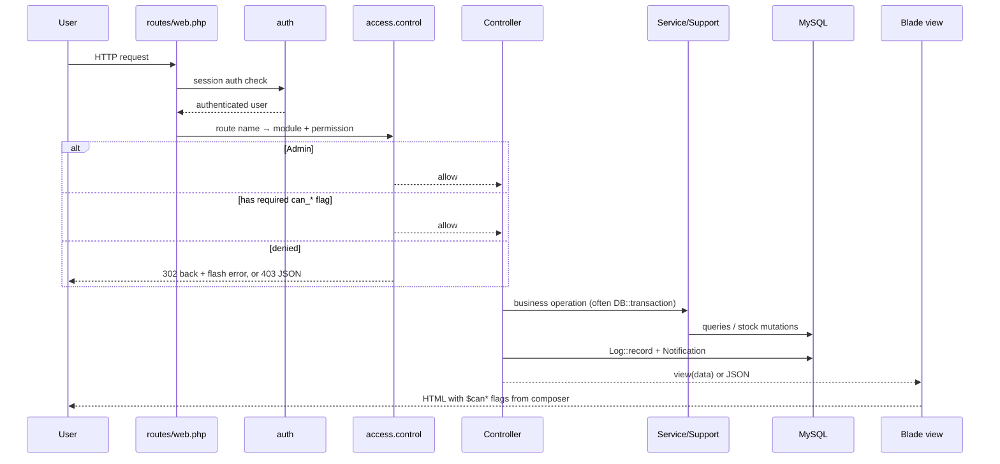
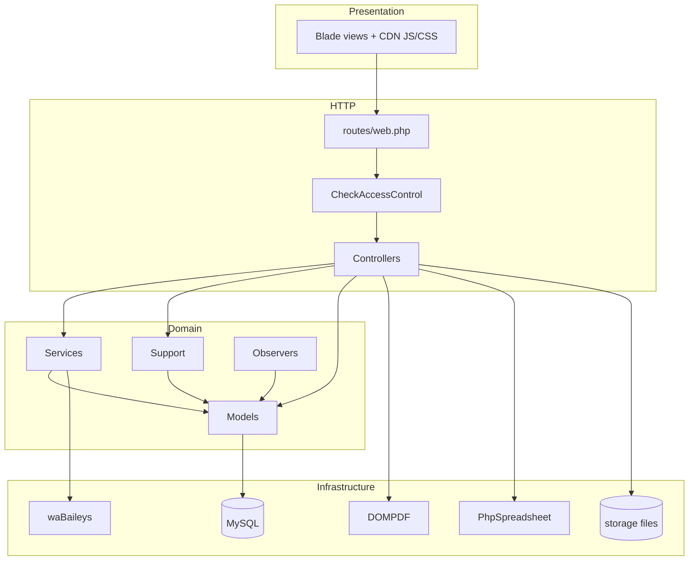

# 01 — Architecture

## 1. Entry points and bootstrapping

| Entry | File | Purpose |
|---|---|---|
| HTTP | `public/index.php` | Laravel front controller |
| Console | `artisan` | Commands and scheduler entry |
| Route registration | `routes/web.php` | All web + business routes |
| Console schedules | `routes/console.php` | Daily task alerts, 5-minute finance reminders |
| App configuration | `bootstrap/app.php` | Routing, middleware alias, proxy trust, exception handling |
| Providers | `bootstrap/providers.php` → `AppServiceProvider` | Observers, global view composer |

`bootstrap/app.php` does three notable things beyond the Laravel default:

1. Trusts all proxies (`$middleware->trustProxies(at: '*')`) for deployment behind TLS termination.
2. Aliases `access.control` to `App\Http\Middleware\CheckAccessControl`.
3. Converts a CSRF 419 on `logout` into a clean session invalidation + redirect to `login`
   instead of showing an error page.

## 2. Layer responsibilities

```
app/
├── Console/Commands/       3 scheduled commands (task alerts, payable, receivable)
├── Http/
│   ├── Controllers/        61 controllers: one per module + shared Concerns
│   └── Middleware/         CheckAccessControl (the only ACL gate)
├── Models/                 127 Eloquent models + Concerns (HasPurchaseDocuments)
├── Observers/              TaskObserver, TaskActivityObserver, ActivityObserver
├── Providers/              AppServiceProvider (observers + global UAC view flags)
├── Services/               Domain services (stock, payroll, imports/exports, WhatsApp, alerts)
├── Support/                Stateless helpers (ACL reads, numbering, tracking, reports)
└── Traits/                 Loggable, Notifiable
```

| Layer | May do | Must not do |
|---|---|---|
| Controller | Validate request, orchestrate transaction, call services/models, return view/JSON, write audit + notification | Re-check module permissions, compute UI permission flags |
| Service | Domain algorithms and invariants (stock, payroll, import/export, WhatsApp) | Render views or gate routes |
| Support | Pure/stateless calculations and shared read helpers | Mutate stock or own request state |
| Model | Relations, casts, status constants, small derived attributes, scopes | Hide multi-step business workflows that need transactions |
| Observer | Side effects on model events (notifications on task/activity changes) | Replace explicit workflow state transitions |
| Middleware | Authenticate + authorise the route's module/permission | Business validation |

There is no repository/interface layer. Eloquent is used directly, per `PANDUAN_MODUL.md`.

## 3. Request lifecycle



### Authentication

- `AuthController` handles `GET/POST /login` and `POST /logout`.
- Login uses **username** (not email), hashed password, and regenerates the session.
- Root `/` redirects to the first module the account can read (`Module::firstAccessibleFor`),
  falling back to `no-access`.
- `/profile` and `/notifications` are deliberately **not** registered as modules: every
  authenticated user may use them.

## 4. Access control (ACL)

### 4.1 Data model

| Table | Role |
|---|---|
| `modules` | One row per module: `module_code`, `module_name`, `route_name` (single segment), `group`, `sort_order` |
| `module_groups` | Sidebar group ordering |
| `user_access_controls` | Per-user, per-module flags: `can_create`, `can_read`, `can_update`, `can_delete`, `can_approve` |

`users.role = 'Admin'` bypasses all checks.

### 4.2 Route → module → permission

`CheckAccessControl`:

1. If no module row matches, **allow** (intentional for routes outside the module registry).
2. Module = substring before the **first dot** of the route name.
   `water-configuration.template-edit` → `water-configuration`.
3. Permission field is chosen from the **last** route-name segment:

| Condition | Permission |
|---|---|
| last segment ∈ `approve, reject, unlock, settle, pay, finalize, void` | `can_approve` |
| last segment = `revise` | `can_update` |
| HTTP `POST` | `can_create` |
| HTTP `PUT` / `PATCH` | `can_update` |
| HTTP `DELETE` | `can_delete` |
| anything else | `can_read` |

4. Denial returns JSON `403 {"success":false,...}` for JSON/Accept requests, otherwise
   `redirect()->back()` with a flash error.

Consequence: approval routes **must** end with an approval verb. Hyphenated verbs such as
`approve-negotiation` would be classified as `can_create` — the trap documented in
`PANDUAN_MODUL.md`.

### 4.3 UI flags

`AppServiceProvider::boot()` registers a global `View::composer('*')` that:

- resolves the module from the same first-dot rule;
- loads the current user's `UserAccessControl` row;
- injects `$canCreate`, `$canRead`, `$canUpdate`, `$canDelete`, `$canApprove`;
- injects product-price flags: `$canViewPrice`, `$canManagePrice`, `$canInputPrice`,
  `$canViewSellingPrice`.

DataTables JSON endpoints do **not** send per-row permission flags. Pages render a JS constant
from the composer flag and compare it with row status/ownership client-side.

Cross-module button flags (for links into another module) cannot come from the route composer.
Controllers obtain them through `ModuleAccess::crossModuleCanRead()` — or an equivalent direct
UAC read, as `ProjectController::show()` does — and pass them to the view as business data. They
are never used as route gates.

### 4.4 Read helpers (not gates)

`App\Support\ModuleAccess` is for UI/data needs that the route-scoped composer cannot answer:

- `ModuleAccess::for($user)->module('MOD_X')->canRead()/canCreate()/...`
- `canManage()` = `canCreate() || canUpdate()`
- `crossModuleCanRead('MOD_X')` for buttons pointing at another module
- `approverUserIds('MOD_X', $exceptUserId)` for notification targets

### 4.5 Additional scopes inside modules

| Scope | Implementation |
|---|---|
| Branch | `users.branch_id` empty = all branches; otherwise `User::canAccessBranch()` limits documents/warehouses |
| Sales ownership | Lead/opportunity queries restrict Sales-role users to owned/assigned records |
| Division | Technical configurations and approvers are filtered by division; IMS product prices are division-scoped |
| Project visibility | Project-scoped documents (`MR`, handovers, PL, DO) resolve through the project |
| Goods request visibility | `GoodsRequest::scopeVisibleTo()` (creator/division/approver rules) |

## 5. Cross-cutting patterns

### 5.1 Status workflows

Models declare string constants, e.g. `Quotation::STATUS_DRAFT`, `PurchaseOrder::STATUS_APPROVED`,
`Invoice::APPROVAL_APPROVED`, plus label arrays and `statusBadgeHtml()`.

Standard approval transition:

```
draft → waiting_approval → approved
                         ↘ rejected → revise → new draft/version
```

Controllers validate the current state, run the transition in `DB::transaction`, write
`Log::record(...)`, and create `Notification` rows.

### 5.2 Versioning (technical configs, quotations)

Fields `group_id`, `version`, `is_current`, `parent_id`.

- `revise` copies header + items, remaps `parent_id`, archives the old `is_current`.
- Approvers can `unlock` an approved document before revision.
- "Latest version" queries group by `group_id` and take the highest id/version.

### 5.3 Document numbering

`App\Support\NumberSequence::make($table, $column, $date, $allowSuffix)` produces
`PREFIX-YYMMNNNN`, incrementing per prefix per year, using the max existing number
(scans matching rows; no separate counter table). Prefixes live in
`config/document_numbers.php`.

Quotation has its own format in `Quotation::generateQuotationNumber()`:
`{seq:03d}/HAS/QT-{initials}/{roman month}/{year}`, reset monthly.

### 5.4 Audit trail

`App\Models\Log::record($action, $description, $moduleCode, $loggable, $user)` writes
`logs` rows with module, actor, polymorphic target. Models use the `Loggable` trait for
`->logs()`. Stock history is separate and append-only in `stock_logs`.

### 5.5 Notifications

- `notifications` table; polymorphic `notifiable` target; `data` JSON.
- `App\Traits\Notifiable` provides `notify(User $user, string $type, ...)`.
- Observers generate many task/activity notifications automatically.
- Frontend polls every 30 seconds; dropdown groups by `group_key` (task/lead/opportunity).
- Types include `task_assigned`, `task_status_changed`, `task_activity`,
  `task_approval_required`, `task_approved`, `mention`, `visit_recorded`,
  `quotation_approval_required`, `quotation_approved`, `quotation_rejected`.

### 5.6 WhatsApp

`App\Services\WhatsAppService` is a transport-only client for the **waBaileys** gateway
(`config/services.php` → `wabaileys`). If URL/API key/sender phone are missing, sends are
skipped with a warning log. Callers:

- `TaskWhatsAppNotifier` — new task, assignees added, approval required
- `TaskAlertService` — H-1 and due-day reminders (08:00 schedule)
- `PayableDueNotifier` / `ReceivableDueNotifier` — daily finance digests through the
  `SendsWhatsAppDigest` concern

### 5.7 Scheduler and queue

`routes/console.php`:

| Time | Job |
|---|---|
| Daily 08:00 | `TaskAlertService::sendAlerts()` |
| Every 5 min | `PayableDueNotifier::send()` |
| Every 5 min | `ReceivableDueNotifier::send()` |

Finance notifiers only actually send once per day at/after the configured send time.
`composer dev` runs `php artisan queue:listen`; `.env.example` uses the `database` queue driver.

### 5.8 PDF and Excel

| Concern | Implementation |
|---|---|
| PDF | `barryvdh/laravel-dompdf`; letterhead partial `resources/views/partials/pdf-letterhead.blade.php`; fonts under `storage/fonts` |
| Excel import | `phpoffice/phpspreadsheet` through `*ImportService` |
| Excel export | `phpoffice/phpspreadsheet` and some hand-built OOXML writers in `*ExportService` |
| Templates | `*XlsxTemplateGenerator` + `XlsxTemplateGenerator` base |

### 5.9 Frontend

- Layout: `resources/views/layouts/app.blade.php` (single large layout with sidebar, topbar,
  notification polling, global JS helpers).
- Main UI depends on CDN assets: Bootstrap 5, Font Awesome, jQuery, DataTables, Select2,
  toastr, SweetAlert2, moment.
- Vite + Tailwind pipeline exists (`vite.config.js`, `resources/css/app.css`,
  `resources/js/app.js`), but the ERP layout itself does not use `@vite`; only the default
  welcome page does. `npm run build` is therefore optional for normal ERP pages, required if
  you rely on Vite-served assets.
- Shared partials: `list-toolbar`, `number-input`, `stock-pick`, `shipment-lines`,
  `purchase-documents`, `pdf-letterhead`.
- Lists use server-side DataTables (`GET module/data`) with search/filter/reset toolbar.

## 6. Dependency relationships



External packages (from `composer.json`):

| Package | Used for |
|---|---|
| `laravel/framework` | Core framework |
| `laravel/tinker` | REPL |
| `barryvdh/laravel-dompdf` | Invoice/quotation/config/PL/DO/payslip PDFs |
| `phpoffice/phpspreadsheet` | Import/export XLSX |
| `phpunit/phpunit`, `mockery`, `collision`, `fakerphp/faker` | Testing |
| `laravel/pint` | Code style |
| `laravel/sail` | Optional Docker dev |
| `laravel/pail` | Log tailing in `composer dev` |

Node dev dependencies: `vite`, `laravel-vite-plugin`, `tailwindcss`, `@tailwindcss/vite`,
`axios`, `concurrently`.
