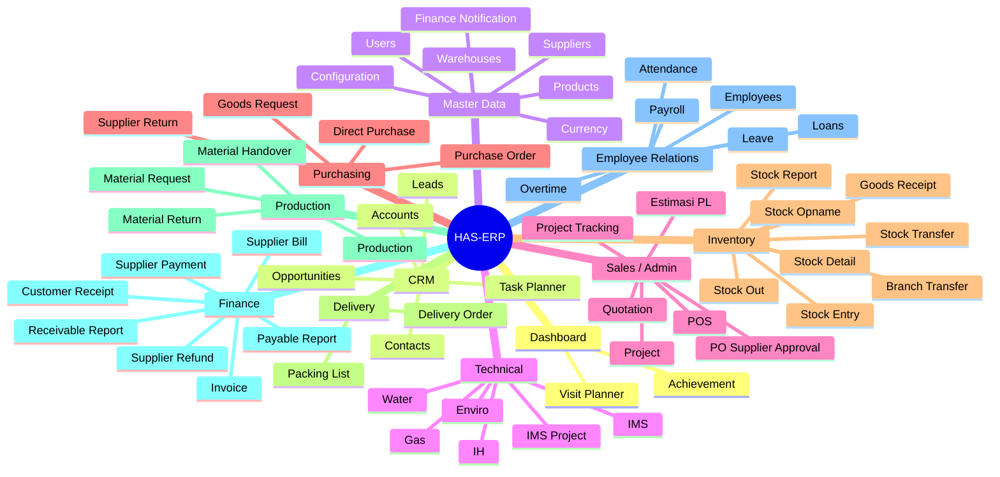
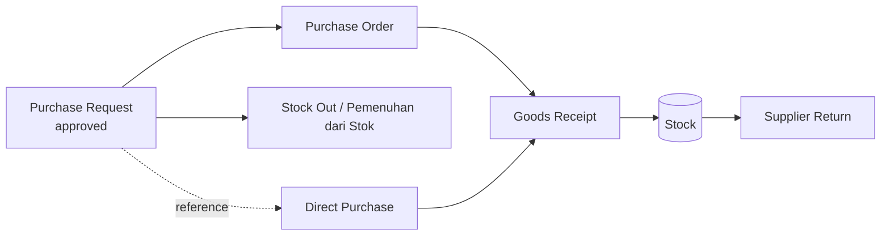
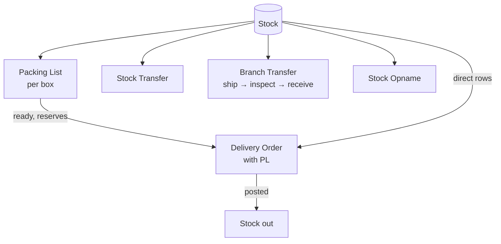
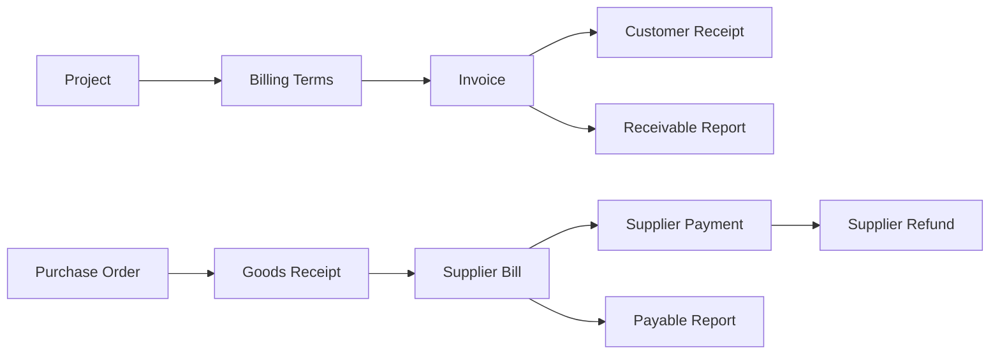

# 02 — Modules

Every module is registered in `database/seeders/ModulesTableSeeder.php` with a
single-segment `route_name`. That value is both the base route name and the ACL module key.
57 modules are seeded.

## 1. Module catalogue

### Dashboard

| Module | Route base | Controller | Responsibility |
|---|---|---|---|
| Visit Planner | `dashboard-visit-planner` | `DashboardVisitPlannerController` | 7-working-day visit schedule per salesperson, grouped by division, based on visit-category tasks |
| Achievement | `dashboard-achievement` | `DashboardAchievementController` | Total achievement and brands sold per division from closed-won/finished quotations |

### CRM

| Module | Route base | Controller | Responsibility |
|---|---|---|---|
| Account Management | `accounts-management` | `AccountManagementController` | Company/account CRUD, billing/shipping addresses, segmentation, hierarchy, import/export XLSX |
| Contact Management | `contact-management` | `ContactManagementController` | Personal contacts linked to accounts; create lead/task from contact; import/export |
| Leads Management | `leads-management` | `LeadsManagementController` | Lead pipeline, qualification, conversion to opportunity, activities/attachments/mentions, 33-column CSV import |
| Opportunity Management | `opportunity-management` | `OpportunityManagementController` | Deal stages, forecast/probability, negotiation/close-loss approval, activities, task creation |
| Task Planner | `task-planner` | `TaskPlannerController` | Task CRUD, assignees, approval flow, visits, proposals, alerts, kanban, import/export |

### Master Data

| Module | Route base | Controller | Responsibility |
|---|---|---|---|
| User Management | `user-management` | `UserManagementController` | User CRUD, branch/division/task-role assignment, per-module ACL assignment |
| Configuration | `configuration` | `ConfigurationController` | Generic CRUD for reference tables via `/configuration/{table}` |
| Product Management | `product-management` | `ProductManagementController` | Master products, pricing rules, material vs serial-number stock type, import/export |
| Currency Management | `currency` | `CurrencyController` | Currencies and conversion rates |
| Supplier | `supplier` | `SupplierController` | Supplier master used by PO/DP/bills/payments |
| Warehouse | `warehouse` | `WarehouseController` | Warehouse master, each owned by one branch |
| Notifikasi Finance | `finance-notification` | `FinanceNotificationController` | Enable/schedule WhatsApp payable & receivable reminders |

`ConfigurationController` covers divisions, job titles, sources, contact methods, segmentation,
business entities/values, role in project, interaction levels, account types, company types,
task roles/categories, forecasts, loss reasons, stages, WhatsApp groups, division handlers,
and branches. The table name is validated against a whitelist config inside the controller.

### Technical configuration (versioned, per division)

| Module | Route base | Controller |
|---|---|---|
| Water Configuration | `water-configuration` | `WaterConfigurationController` |
| IMS Configuration | `ims-configuration` | `ImsConfigurationController` |
| Enviro Configuration | `enviro-configuration` | `EnviroConfigurationController` |
| IH Configuration | `ih-configuration` | `IhConfigurationController` |
| Gas Configuration | `gas-configuration` | `GasConfigurationController` |
| IMS Project | `ims-project` | `ImsProjectController` |

Shared behaviour (Water/Enviro/IH/Gas; IMS differs in item pricing):

- Header derived from task → opportunity → lead (customer, location, PIC, sales).
- Hierarchical parent/child items; unit locked to the master product (IMS allows free price/unit input).
- `draft → waiting_approval → approved/rejected`, approver must belong to the same division and
  must not be the creator; Admin can override.
- Versioning: `group_id` + `version` + `is_current`; `unlock` allows revision; `revise` clones.
- Templates: `ConfigurationTemplate` + `ConfigurationTemplateItem`, handled by the
  `ConfigurationTemplateHandling` trait; template prefill is DFS ordered.
- PDF export via DomPDF; every transition is logged.

`MaterialRequestTemplateController` is a tab inside Material Request, not a separate module.

### Sales / Admin

| Module | Route base | Controller | Responsibility |
|---|---|---|---|
| Quotation | `quotation` | `QuotationController` | Final quotation from approved configurations; pricing engine, approval/versioning, PDFs, PO upload hand-off to Project |
| Estimasi PL | `profit-estimate` | `ProfitEstimateController` | Revenue/cost estimate per quotation; sync from sources, outdated marker, PDF |
| POS | `pos` | `PosController` | Sales order bridging quotation → project; flat items; approval |
| Project | `project` | `ProjectController` | Project creation from approved/finished quotation, customer PO, billing terms, achievements, warranty, documents |
| Project Tracking | `project-tracking` | `ProjectTrackingController` + `ProjectTracker` | Seven-stage automatic progress monitor with warnings |
| PO Supplier Approval | `po-supplier-approval` | `PoSupplierApprovalController` | Two-approver quorum per project before purchasing; closes opportunity as Closed Won |

**Quotation rules**

- Prefills from every approved technical configuration of the task.
- Three item groups: main items, configuration snapshot items, cost items (cost does not affect subtotal).
- `Quotation::calculateTotals()`: `subtotal = Σ(qty × selling_price)`, discount (% or manual),
  `dpp = subtotal − discount`, PPN (% or manual) on DPP, `grand_total = dpp + ppn`.
- One task may have one current quotation; all configurations must be approved first.
- Maximum two sales users (`sales_ids`) taken from Sales-division task assignees plus creator.
- Approval workflow submit/approve/reject/unlock/revise + versioning.
- Uploading the customer PO moved to Project; project marks quotation `finish`.

**Project rules**

- Created from `approved`/`finish` quotation that has a Profit Estimate; one quotation can yield
  multiple projects.
- Number `PRJ-YYMMNNNN`.
- Stores customer PO number/date/due date/documents; sets quotation `finish`.
- `total_sale_amount` comes from quotation `grand_total`; `net_sale_amount` from
  `profit_estimates.real_project_value`.
- Billing-term percentages are capped at 100% of the contract base (`subtotal − discount`, before
  PPN); a term with an active invoice is locked; out-of-term invoices require a reason.
- Sales split evenly with rounding remainder to the last sales.
- Detail page shows project stock, DOs, purchase cost vs profit estimate, warranty, tasks.

**POS rules**

- Requires a quotation that already has a Profit Estimate.
- Flat item list; description is the customer-facing naming.
- `draft → waiting_approval → approved/rejected`; approval recorded with approver/rejecter.
- Project creation from a quotation with POS goes through the Project module.

**PO Supplier Approval rules**

- Approval is per project, not per quotation.
- Quorum = 2 distinct approvers (`ProjectPoSupplierApproval`).
- On full quorum, the opportunity behind the quotation becomes `Closed Won`; purchasing may
  proceed for the project.

### Purchasing

| Module | Route base | Controller | Responsibility |
|---|---|---|---|
| Purchase Request | `goods-request` | `GoodsRequestController` | Internal purchase request for a project or free stock; approval, partial fulfilment, close-remaining |
| Purchase Order | `purchase-order` | `PurchaseOrderController` | Supplier PO from approved PR items; approve/void/revise; PDF |
| Direct Purchase | `direct-purchase` | `DirectPurchaseController` | Purchase without PR for stock/project/direct use; auto supplier bill on approval |
| Retur ke Supplier | `supplier-return` | `SupplierReturnController` | Return received goods and reduce stock |

Key rules:

- PR purpose `project` requires an active project with 2/2 PO Supplier Approval; purpose `internal`
  has no project.
- PR items must reference master products; units come from the master.
- PR needs 1 approver; remaining quantities can be fulfilled from PO and/or stock.
- PO only consumes approved PR items, one currency, payment terms, revision `…REV`, void.
- Direct Purchase destinations: free stock, project stock, direct use. `Add from Material Request`
  for stock purpose suggests `remaining MR − available stock − in-purchase`.
- Supplier return selects concrete stock rows and reduces received quantity and stock.

### Inventory and Delivery

| Module | Route base | Controller | Responsibility |
|---|---|---|---|
| Penerimaan Barang | `goods-receipt` | `GoodsReceiptController` | Receive from PO/DP into free or project stock, or direct use; SN may follow later |
| Pemenuhan dari Stok | `stock-out` | `StockOutController` | Fulfil approved PR items from free stock; allocate project requests |
| Packing List | `packing-list` | `PackingListController` | Per-box packing of project goods; draft → ready → shipped |
| Delivery Order | `delivery-order` | `DeliveryOrderController` | Direct or packing-list delivery; posting moves stock out |
| Transfer Stok | `stock-transfer` | `StockTransferController` | Move within a branch and/or change free/project ownership |
| Branch Transfer | `branch-transfer` | `BranchTransferController` | Inter-branch shipment with inspection at destination |
| Masuk Stok Lain-lain | `stock-entry` | `StockEntryController` | Opening balance, returns, grants/samples |
| Stock Opname | `stock-opname` | `StockOpnameController` | Physical count and adjustment through `StockService::adjust` |
| Lengkapi Data Stok | `stock-detail` | `StockDetailController` | Fill/correct SN, batch/MFG, expiry, warranty; per-SN history |
| Laporan Stok | `stock-report` | `StockReportController` | Balances by product/warehouse/branch/ownership, valuation, in-transit, stock card |

Packing List and Delivery Order rules:

- One PL row = one box: description, order qty, ship qty, dimensions, weight; contents are stock rows.
- PL lifecycle `draft → ready → shipped`; ready reserves stock; shipping happens when the DO is posted.
- DO has two exclusive paths: **direct** (document rows carry project stock rows, SN printed) or
  **with packing list** (loads a ready PL from the same project/warehouse, serial column references boxes).
- Posting is done by the warehouse without a separate approval and releases stock.
- Both documents have company-format PDFs; PL optionally appends SN/batch details per box.

### Production

| Module | Route base | Controller | Responsibility |
|---|---|---|---|
| Material Request | `material-request` | `MaterialRequestController` | Material needs for an active project in one branch; approval |
| Serah Terima Material | `material-handover` | `MaterialHandoverController` | Warehouse hands approved MR stock to production; stock leaves immediately |
| Produksi | `production` | `ProductionController` | Consume handed-over material into finished goods (non-SN) in the same branch |
| Retur Material Produksi | `material-return` | `MaterialReturnController` | Return unused material to the original warehouse as free stock |

- MR saved = waiting approval; approved by 1 approver; rejected can be corrected and resubmitted;
  completed automatically when all items are handed over, or closed manually.
- Handover allocates free stock to the project before consuming it; project-owned stock is not
  double-counted; SN units must have SN.
- Production cost = Σ material ÷ finished qty; project cost does not increase again.
- Material return quantity = handed-over − posted production usage − approved returns. Free-stock
  origin releases its project allocation; project-owned material stays on the project.

### Finance

| Module | Route base | Controller | Responsibility |
|---|---|---|---|
| Invoice | `invoice` | `InvoiceController` | Project invoices per term; approval separate from payment status; PDF |
| Penerimaan Customer | `customer-receipt` | `CustomerReceiptController` | Customer receipts, approve/void, documents, open-invoice picker |
| Laporan Piutang | `receivable-report` | `ReceivableReportController` + `ReceivableReport` | Receivable aging, term positions, forecast, export |
| Tagihan Supplier | `supplier-bill` | `SupplierBillController` | Supplier bills with 3-way match, advances, charges, PPh, tax invoice |
| Pembayaran Supplier | `supplier-payment` | `SupplierPaymentController` | Partial/multi-bill payments, FX, approve/void |
| Refund Supplier | `supplier-refund` | `SupplierRefundController` | Refund of cancelled-PO advances or short deliveries |
| Laporan Hutang | `payable-report` | `PayableReportController` + `PayableReport` | Payable aging, payment schedule, project cost vs estimate, export |

Invoice rules:

- One project may have many invoices; number `INV-YYMMNNNN`.
- Item descriptions are sanitised server-side; lines can be manual or picked from a quotation.
- `amount_payment = subtotal × percent_payment / 100`; `ppn` stored as a percent and computed
  from the payment amount; `total_payment = amount_payment + PPN`.
- `approval_status`: `draft → waiting_approval → approved/rejected`.
- Payment status: `unpaid`, `paid`, `cancelled`.
- Editable/deletable only in `draft`/`rejected`; PDF watermark until approved.

Supplier bill rules:

- 3-way match PO × goods receipt × bill.
- Automatic advance and deduction handling, additional charges, configurable PPh rate plus
  withholding slip, mandatory tax invoice for PKP suppliers.
- Payment allocations support partial and multiple bills; FX rates are stored per document.

### Employee Relations (HR)

| Module | Route base | Controller | Responsibility |
|---|---|---|---|
| Data Karyawan | `employee-management` | `EmployeeManagementController` | Employee CRUD, family, terminate/reactivate, salary component overrides |
| Absensi Karyawan | `attendance` | `AttendanceController` | Manual/device attendance, approvals, geofence offices, shifts, corrections |
| Pengajuan (Cuti/Izin) | `leave-request` | `LeaveRequestController` | Leave types, working-day calculation, balances, approve/reject/revise/cancel |
| Pengajuan Lembur | `overtime-request` | `OvertimeRequestController` | Overtime hours from attendance, multiplier approval, payroll integration |
| Peminjaman | `loan` | `LoanController` | Employee loans with installment schedule, payments, early settlement |
| Penggajian/Payroll | `payroll` | `PayrollController` + `PayrollService` | Cutoff periods, compile → draft → finalize, payslips, exports |

- Payroll cutoff is day 25 → day 24 of the following month; `is_thr` is automatic for the configured THR month.
- `PayrollService` handles prorated salary, monthly/daily components, BPJS employee+company,
  PPh21, loan installments, unpaid leave, Excel export and PDF payslips.
- Rates and constants live in `config/er.php`.

### System (not registered modules)

| Area | Controller | Notes |
|---|---|---|
| Login/logout | `AuthController` | Guest group for login; username + session regeneration |
| Profile | `ProfileController` | Every authenticated user; not an ACL module |
| Notifications | `NotificationController` | Bell polling, all-notifications page, mark read |

## 2. Route conventions

- Resource module: `Route::resource('module', XxxController::class)`.
- JSON/DataTables: `GET module/data` → `module.data`.
- Workflow verbs: `POST module/{id}/approve` → `module.approve`, likewise `reject`, `submit`,
  `revise`, `unlock`, `void`, `settle`, `pay`, `finalize`.
- Nested action names may have three segments (`attendance.corrections.approve`); the middleware
  still checks the **last** segment for approval verbs.
- Module ACL key is always the first segment of the route name.
