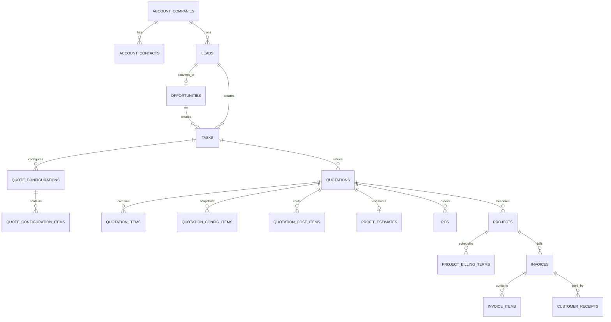
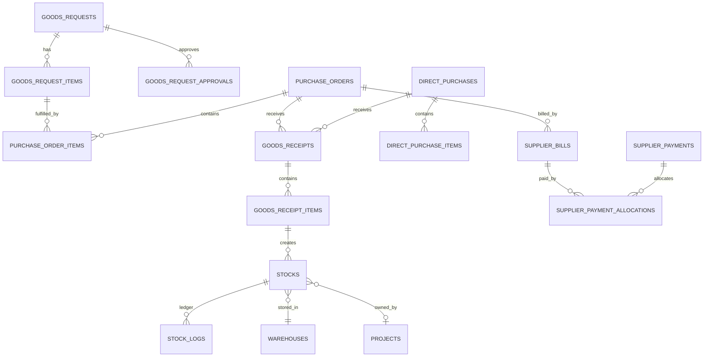

# 03 — Domain data model

Schema is managed by 214 migrations. `skema.md` contains column-level notes for the core CRM
tables; this page maps domains, relationships and invariants.

## 1. Data domains

| Domain | Core tables |
|---|---|
| Access | `modules`, `module_groups`, `user_access_controls` |
| Organisation | `users`, `branches`, `divisions`, `warehouses` |
| CRM | `account_companies`, `account_contacts`, `leads`, `opportunities`, `activities`, `activity_attachments` |
| Tasks | `tasks`, `task_assignees`, `task_activities`, `task_visits`, `task_proposals`, `task_categories`, `handling_groups` |
| Technical config | `quote_configurations`, `quote_configuration_items`, `configuration_templates`, `configuration_template_items` |
| Sales | `quotations`, `quotation_items`, `quotation_config_items`, `quotation_cost_items`, `pos`, `pos_items`, `profit_estimates`, `profit_estimate_lines` |
| Project | `projects`, `project_billing_terms`, `project_achievements`, `sales_achievements`, `project_warranties`, `quotation_po_supplier_approvals` (project-scoped approvals) |
| Purchasing | `goods_requests`, `goods_request_items`, `goods_request_approvals`, `purchase_orders`, `purchase_order_items`, `direct_purchases`, `direct_purchase_items`, `suppliers`, `supplier_returns`, `supplier_return_items` |
| Inventory | `stocks`, `stock_logs`, `goods_receipts`, `goods_receipt_items`, `stock_entries`, `stock_entry_items`, `stock_transfers`, `stock_transfer_items`, `branch_transfers`, `branch_transfer_items`, `stock_opnames`, `stock_opname_items` |
| Delivery | `packing_lists`, `packing_list_boxes`, `packing_list_items`, `delivery_orders`, `delivery_order_items`, `delivery_order_item_stocks` |
| Production | `material_requests`, `material_request_items`, `material_request_templates`, `material_request_template_items`, `material_handovers`, `material_handover_items`, `productions`, `production_items`, `material_returns`, `material_return_items` |
| Finance AR | `invoices`, `invoice_items`, `customer_receipts` |
| Finance AP | `supplier_bills`, `supplier_bill_items`, `supplier_payments`, `supplier_payment_allocations`, `supplier_refunds` |
| HR | `employees`, `employee_families`, `employee_salary_components`, `salary_components`, `offices`, `shifts`, `attendances`, `attendance_approvals`, `attendance_corrections`, `leave_types`, `leave_requests`, `leave_balances`, `leave_request_logs`, `overtime_requests`, `loans`, `loan_installments`, `payroll_periods`, `payslips`, `payslip_components`, `payroll_logs` |
| Cross-cutting | `documents`, `logs`, `notifications`, `app_settings`, `currencies`, `master_products` |

## 2. Commercial chain



Important relationship decisions:

| Model | Key relations / behaviour |
|---|---|
| `Lead` | Owns/assigns to users, belongs to company/contact; conversion creates `Opportunity` |
| `Opportunity` | Belongs to lead/company/contact; stage, forecast, loss reason; closed automatically by project PO approval |
| `Task` | Creator, many assignees, category, handling group, optional lead/opportunity/project/contact; activities, visits, proposals, quote configurations, quotations |
| `QuoteConfiguration` | Belongs to task/opportunity/division; version chain via `group_id`, `parent_id`, `revisionChildren`, `groupVersions` |
| `Quotation` | Items/config/cost items, opportunity, task, creator, sales snapshot (`sales_ids`), profit estimate, POS, revision chain, group versions |
| `Pos` | Belongs to quotation/company/project; flat `PosItem` rows; approval fields |
| `Project` | Belongs to quotation/company; has billing terms, invoices, delivery orders, supplier approvals, achievements, warranty, tasks, polymorphic documents |
| `Invoice` | Belongs to project/POS/billing term; has items, receipts; separate approval status and payment status |

## 3. Procurement and stock relationships



### Stock model

Two tables, one ledger:

| Table | Meaning |
|---|---|
| `stocks` | Current balance rows |
| `stock_logs` | Append-only history; `qty` signed (+ in, − out, 0 for detail updates) |

Stock row dimensions:

- `master_product_id`, `warehouse_id`, `project_id` (`null` = free stock), `is_material`.
- **Material** (`is_material = true`): one permanent balance row per product + warehouse + ownership.
  Receipts add to the weighted-average cost; no lot tracking.
- **Serial-number goods**: one row per physical unit, with `serial_number`, optional batch, expiry,
  warranty and unit cost.
- Reserved quantity comes from ready Packing List items; `StockPicker` exposes `available = qty − reserved`.
- Serial-numbered units without an SN cannot leave to a customer, supplier, or internal use.

`StockLog` constants define every movement: `in`, `out`, `allocate`, `transfer_out`, `transfer_in`,
`adjust`, `return_supplier`, `detail_update`, `ship_out`, `ship_in`, `merge`.
`ref_type` + `ref_id` are polymorphic; `StockLog::attachDocuments()` resolves the source document
using the private `REF_MAP` (goods receipt item, stock entry, opname, transfer, PL item, DO item,
supplier return, goods request item, branch transfer, material handover/return, production).

### Stock invariants

1. All quantity changes go through `App\Services\StockService`; rows are locked in id order.
2. Callers must run inside `DB::transaction` and lock rows first (`StockService::lock()`).
3. `StockException` carries domain errors (negative quantity, SN rules, missing serial).
4. Material may leave partially; serial goods always leave whole units.

## 4. Production relationships

```
material_requests (project, branch, status)
  └── material_request_items
        └── material_handovers → material_handover_items (stock rows frozen)
              ├── production → production_items (consumed)
              └── material_returns → material_return_items (unused)
```

- Handover freezes `unit_cost` for project costing.
- Production creates finished-goods stock rows (non-SN) owned by the project.
- Material return writes `in` stock and, when the material came from free stock, a negative
  `allocate` log to release the project allocation.

## 5. HR relationships

```
employees ── employee_families
          ├── employee_salary_components ── salary_components
          ├── attendances ── attendance_approvals
          │                 └── attendance_corrections
          ├── leave_requests ── leave_balances / leave_request_logs
          ├── overtime_requests
          ├── loans ── loan_installments
          └── payslips ── payslip_components
payroll_periods ── payslips
               └── payroll_logs
```

`offices` store geofences; `shifts` define working hours. Payroll periods are non-overlapping by
construction (`25 → 24`), and finalized periods are locked.

## 6. Status constants by entity

| Entity | Statuses |
|---|---|
| Quotation | `draft`, `waiting_approval`, `approved`, `rejected`, `archived`, `finish` |
| Quote configuration | `draft`, `waiting_approval`, `approved`, `rejected`, `archived` |
| POS | `draft`, `waiting_approval`, `approved`, `rejected` |
| Goods Request | `draft`, `waiting_approval`, `approved`, `rejected` (+ fulfilment states) |
| Purchase Order | `draft`, `waiting_approval`, `approved`, `rejected`, `partially_received`, `received`, `cancelled` |
| Packing List | `draft`, `ready`, `shipped` |
| Delivery Order | `draft`, `posted` |
| Invoice approval | `draft`, `waiting_approval`, `approved`, `rejected` |
| Invoice payment | `unpaid`, `paid`, `cancelled` |
| Project | `active`, `completed`, `cancelled`; types `project`, `retail`; IMS hybrid records use `scopeImsHybrid` |
| Task | `todo`, `in_progress`, `waiting_approval`, `done`, `cancelled` |

## 7. Document numbering

`NumberSequence` uses `config/document_numbers.php` and produces `PREFIX-YYMMNNNN`, reset yearly.

| Group | Prefixes |
|---|---|
| Admin | Project `PRJ`, POS/Sales Order `SO` |
| Purchasing | PR `PR`, PO `PO`, Direct Purchase `DPO`, Supplier Return `RTV` |
| Inventory | Goods Receipt `GRN`, Packing List `PKL`, Delivery Order `DO`, Stock Transfer `ST`, Stock Entry `SE`, Stock Opname `SC`, Branch Transfer `BT` |
| Production | Material Request `MR`, Material Handover `MH`, Production `MO`, Material Return `RMP` |
| Finance | Invoice `INV`, Customer Receipt `RV`, Supplier Bill `BILL`, Supplier Payment `PV`, Supplier Refund `RFD` |

Exceptions:

- **Quotation** uses `{seq:03d}/HAS/QT-{initials}/{roman month}/{year}`, monthly reset.
- HR documents and third-party numbers (customer PO, supplier invoice, tax invoice) do not use
  `NumberSequence`.

## 8. Polymorphic and shared structures

| Structure | Used by |
|---|---|
| `documents` (`documentable_type/id`) | Project, Purchase Order, Direct Purchase, Goods Receipt, Invoice, Customer Receipt, Supplier Bill/Payment; shared traits `HasPurchaseDocuments` + `ManagesPurchaseDocuments` |
| `logs` (`loggable_type/id`) | Any model using `Loggable` (tasks, quotations, configs, purchases, etc.) |
| `notifications` (`notifiable_type/id`) | Task, lead, opportunity, quotation and other entities |
| `stock_logs.ref_type/ref_id` | Source document for each stock movement |

Document upload validation is centralised in `Document` (`MAX_FILES`, `VALIDATION_RULE`) and the
`ManagesPurchaseDocuments` controller concern. Allowed document types and delete policy are
declared per model.
