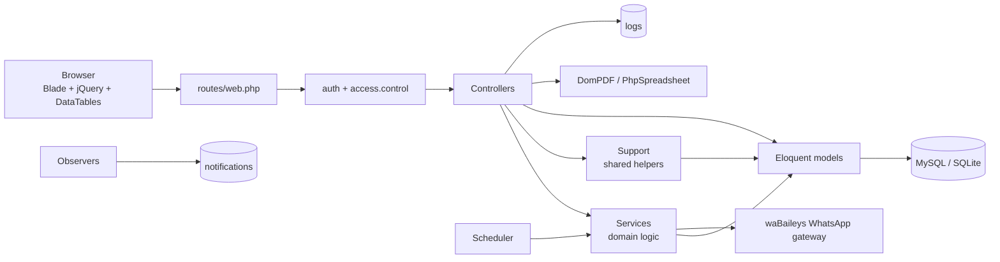
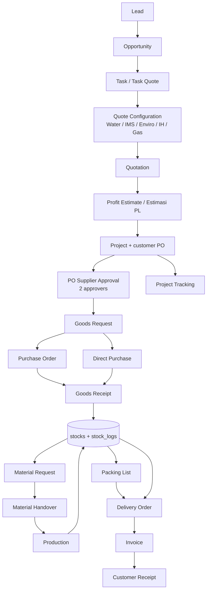

# HAS-ERP Code Wiki

Code-level documentation for HAS-ERP, a Laravel ERP/CRM that runs the whole commercial chain
**Lead → Opportunity → Task → Quote Configuration → Quotation → Project → Purchasing → Receiving →
Production → Packing List → Delivery Order → Invoice**, plus Inventory, Finance (AP/AR),
Project Tracking, and Employee Relations (HR).

This wiki describes how the code is organised, which class owns which responsibility, how modules
depend on each other, and how to run and test the project. Business rules that already have
dedicated documents are linked rather than duplicated.

## Wiki map

| Page | Contents |
|---|---|
| [01-architecture.md](01-architecture.md) | Request lifecycle, layers, ACL model, cross-cutting patterns, dependencies |
| [02-modules.md](02-modules.md) | Module catalogue, routes, controllers, responsibilities, workflows |
| [03-domain-data-model.md](03-domain-data-model.md) | Data domains, key tables, relationships, stock ledger, numbering |
| [04-key-classes.md](04-key-classes.md) | Key controllers, services, support helpers, models, observers, commands |
| [05-development.md](05-development.md) | Setup, running, environment, testing, conventions, extension guide |
| [07-credit-note-design.md](07-credit-note-design.md) | Credit note supplier design for post-return bill adjustment |

Existing repository documents that remain authoritative:

| Document | Scope |
|---|---|
| `README.md` | Product-level feature description and per-module behaviour |
| `PANDUAN_MODUL.md` | Mandatory conventions for adding modules (ACL, routes, workflow) |
| `skema.md` | Detailed table/column schema notes |
| `desaindatabases.md` | Initial CRM table design |
| `NOTIFICATION_SYSTEM.md` | Notification internals |
| `employee-management.md` | Employee Relations design |
| `RENCANA_PACKING_LIST.md` | Packing List / Delivery Order design decisions |
| `RENCANA_PROJECT_TRACKING.md` | Project Tracking design decisions |
| `SIMULASI_ALUR.md` | End-to-end simulation SOP |

## Snapshot

Facts below were read from the working tree at documentation time:

| Item | Value |
|---|---|
| Framework | Laravel 12 (`laravel/framework ^12.0`), PHP `^8.2` |
| Database | Eloquent ORM; production connection MySQL/MariaDB `has_erp`; tests SQLite `:memory:` |
| Session / queue / cache | `database` drivers in `.env.example`; tests use `array` / `sync` |
| Controllers | 61 concrete controllers in `app/Http/Controllers` |
| Eloquent models | 127 in `app/Models` |
| Migrations | 214 in `database/migrations` |
| Seeders | 27 in `database/seeders` |
| Registered modules | 57 rows seeded by `ModulesTableSeeder` |
| Route declarations | ~498 in `routes/web.php` (653 lines) |
| Blade views | 193 `.blade.php` files in `resources/views` |
| Tests | 73 feature files + 2 unit files |

## Architecture at a glance



Key rules:

1. **One access gate** — every business route sits inside `Route::middleware(['auth', 'access.control'])`.
   Controllers never re-implement permission gates.
2. **One source of UI flags** — the global view composer in `AppServiceProvider` injects
   `$canCreate/$canRead/$canUpdate/$canDelete/$canApprove` into every view.
3. **One stock mutation path** — every quantity change goes through `App\Services\StockService`,
   which appends to `stock_logs`.
4. **Data-driven navigation** — sidebar order and visibility come from `modules` and `module_groups`,
   not hardcoded menus.
5. **Document workflow convention** — string status constants on models, `draft → waiting_approval →
   approved/rejected`, audit via `Log::record()`, versioning via `group_id` + `version` + `is_current`.

## Main business flow



## Running in one minute

```bash
composer install
cp .env.example .env
# set DB_CONNECTION=mysql, DB_DATABASE=has_erp, DB_USERNAME, DB_PASSWORD
php artisan key:generate
php artisan migrate --seed
npm install && npm run build
php artisan serve
```

Full details, environment variables, queue/scheduler and test commands are in
[05-development.md](05-development.md).
